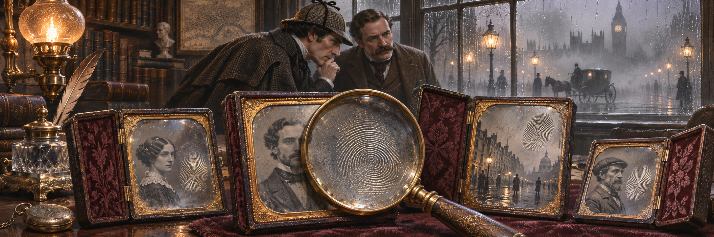

Every photo archive eventually asks the same small question: is this the same photo as that one? It sounds like a yes-or-no question. It is really five questions wearing one word, and an archive gets into trouble when it answers one of them and acts as if it had answered another.

[phidentify](https://github.com/firstpair/phidentify) is our answer to that. It computes several identities for a photo file, gives each one a name, and refuses to let any of them stand in for another. It is a Rust library with a C ABI and an OCaml package that builds with both stock OCaml and OxCaml. The [manual](https://firstpair.org/books/phidentify/) is on the First Pair Photography and Unix shelves.

## Five questions behind one word

Take a DNG and the copy of it in last year's backup. Their checksums differ. What does that mean?

Perhaps a rating changed. Lightroom can write metadata straight into a DNG, so a single star rewrites the XMP packet inside the file and changes the whole-file hash. The photograph is untouched. Perhaps the embedded preview was refreshed after an edit. Perhaps a converter moved the image data further into the file to make room for a larger packet. Or perhaps one byte of raw data was damaged on a failing drive, and the photograph really is different.

A whole-file checksum cannot tell these apart. It was never meant to. It answers "are these the same bytes?" and nothing else, and it answers that perfectly. The mistake is to ask it the other questions.

So phidentify asks them separately:

- **Whole-file SHA-256**: are the bytes identical?
- **DNG encoded raw blocks**: is the stored raw data the same, whatever happened to the metadata around it?
- **Lightroom Classic original fingerprint**: would Lightroom Classic accept this file as the original its catalog recorded?
- **Metadata record**: is the metadata the same, and if not, which fields changed?
- **Preserved digest**: is everything except the XMP packet identical?

Each has a name in every interface, and each reports one of three things: a value, a failure with a reason, or "not attempted". The last two are never a match. Two files that both failed to parse have not agreed on anything.

## The raw data, without the wrapper

The raw-block identity came from [dng-compare](https://github.com/firstpair/dng-compare), our tool for comparing DNG archives. Its `dng-subset` scanner pairs files and checks whether their encoded raw blocks match, block by block, without decoding. phidentify turns that comparison into a digest: the byte order, then for each primary raw image the encoding tags, the block counts and the block bytes, under a fixed domain string. Two DNGs get the same digest exactly when dng-subset would call them equal.

What it leaves out is the point. Offsets are not hashed, so a file whose image data moved when its metadata grew keeps its identity. XMP, previews and maker notes are not hashed. A keyword edit cannot change it. A flipped raw byte always does.

It is not a pixel identity. The same samples re-encoded with different compression get a different digest. Deciding that question needs decoding, and dng-compare does that when it has to.

## Lightroom's own idea of "the same"

Lightroom Classic keeps a fingerprint of every original in its catalog. When files move, or a library is restored, that value is how Classic recognizes its originals. If you want to know whether a file on disk is the one a catalog entry means, you need that value, and only Lightroom used to be able to compute it.

phidentify reimplements it for the DNGs it supports: integer, single-plane CFA or LinearRaw classic-TIFF DNGs, uncompressed or with lossless JPEG compression, with the two raw-image opcodes it implements. It decodes the raw samples before linearization, computes Adobe's NewRawImageDigest over them, and wraps that with the camera model, the default and user crops and a fingerprint of the opcode lists, all with MD5, as Lightroom does. It contains no Adobe code. Any file outside those strata is an error, never a guess.

The only evidence that matters for an identity like this is agreement with the original. On 2026-11-01 we fingerprinted 60 randomly chosen DNGs from a Lightroom Classic 15 catalog, and all 60 matched the values Classic had stored. That is what the identity claims, and all it claims: an equal fingerprint means Classic's matcher would pair the files. It does not mean their bytes or their pixels are equal.

## Metadata as a record, not a byte range

The metadata identity uses dng-compare's in-process exiftool-rs engine, which writes an ExifTool-shaped JSON record for each file. phidentify hashes that record without the members that only say where the file sits, its name, folder and dates, so a moved file keeps its metadata identity.

It keeps the engine's own stamp in the hash. That looks fussy, and it is deliberate. A different engine, or a newer version of the same one, can read the same file slightly differently. If records from two engines could compare equal, an archive would one day conclude that metadata had changed when only the reader had. With the stamp in the hash, records from different engines never compare at all.

For the question people usually ask next, "what changed?", there is a field-by-field diff. For storage, there is a compact form that replaces long strings such as base64 thumbnails with their SHA-256 and length.

## Everything except the packet

The last identity is the one a synchronizer needs. [Semantic Unison](https://github.com/querygraph/semantic-unison), our fork of the Unison file synchronizer, sends DNG metadata edits without resending image bytes. Before it does, it has to prove that the receiver's file and the sender's differ only in their XMP packets. Its proof is a hash of every byte outside the packet, with the file size and the packet's position bound in. Unison calls it `SDE/0-preserved`.

Finding the packet safely is the hard part, and it is the job of [tiffgraph](https://github.com/firstpair/tiffgraph), our pure-OCaml TIFF/DNG graph walker. Under a fixed grammar it locates the primary packet and checks that nothing else the file declares lies inside it. Unison's peers negotiate which grammar they trust, from the strict `dng-xmp/0` to `dng-xmp/2`, which also admits the private fields camera converters write.

phidentify walks each DNG with the strictest grammar that accepts it, records which one, and computes the same preserved digest. We cross-checked it byte for byte against Unison's own implementation on 60 DNGs: every file both accepted got the same grammar and the same digest, and the files without a packet were refused by both. Two files with equal preserved digests, under the same grammar, can differ only inside the packet. That makes it the precise answer to "was this only a metadata edit?"

## Parallel, in two kinds of OCaml

The OCaml package identifies many files at once with a pool of domains. Under stock OCaml 5 it uses `Domain.spawn`. Under OxCaml it uses `Domain.Safe.spawn`, which accepts only portable closures, so the workers share nothing but an immutable list of paths and an atomic counter. The tiffgraph walk runs inside each worker, over a file descriptor the worker opened itself, and the Rust core runs with the OCaml runtime lock released. dune picks the right pool for the switch, and the test suite runs in both.

## What the names buy

With the identities named, the archive questions get short answers. Is this file in my backup? Same SHA-256, yes; same raw blocks, the photograph is there but this version is not; same preserved digest, the backup plus this file's XMP packet restores it exactly. Did the copy that went out on a portable drive come back intact? Only SHA-256 answers that. Is this the original my catalog recorded? Only the Lightroom fingerprint answers that, and only for the files it supports.

None of those answers is hard. What is hard is keeping them apart, especially when one of them is missing. phidentify's rule is the one that makes an archive trustworthy: a failed or missing identity is not a match, and one identity never answers for another.

The [manual](https://firstpair.org/books/phidentify/) covers each identity in detail, with exact formulas, failure reporting and cost, the Rust, C and OCaml interfaces, and a worked guide to which identity answers which question. Its [PDF](https://firstpair.org/phidentify/pdf/), [EPUB](https://firstpair.org/phidentify/epub/) and [HTML](https://firstpair.org/read/phidentify/) editions are on the shelf, and the code is MIT-licensed at [github.com/firstpair/phidentify](https://github.com/firstpair/phidentify).

## Update, 2026-11-02: phidentify 0.2.0

The first version of this post described phidentify 0.1.0 and its five identities. Pointing an indexer at real archives the same day showed a gap, and phidentify 0.2.0 fills it with a sixth identity. The [manual](https://firstpair.org/books/phidentify/) now covers 0.2.0.

### The camera clock was wrong

Every photographer has shot a trip with the camera clock on home time, or an hour off after daylight saving, and fixed it afterwards with ExifTool or Lightroom. The fix rewrites a few bytes of EXIF in every file. The pictures are untouched, but every whole-file SHA-256 is new, and a backup check by checksum now says none of those photos is backed up.

For DNGs, the raw-block identity already survived that. For everything else, phidentify had nothing between "same bytes" and "same metadata record". So it gained `image_data`: a SHA-256 of the stored image bytes only. For a TIFF or a TIFF-based raw, such as NEF, CR2, ARW, 3FR, PEF or ORF, that is the strips and tiles of every directory. For a Panasonic RW2, whose raw data has no byte counts, it is everything from RawDataOffset to the end of the file. For a Fujifilm RAF, it is the CFA section the header names. For a JPEG, it is the frame, the tables and the compressed scans, without the APP segments that hold EXIF, XMP, ICC profiles and thumbnails, without comments, and without whatever a camera appended after the end-of-image marker. It all goes under its own domain string, `PHIDENTIFY-IMAGE-DATA-1`, with every block's length bound in, and the manual gives the exact framing.

We checked it on real files rather than only on synthetic ones. Shifting the capture time of a TIFF, an ARW, an RW2 and a JPEG with ExifTool changed every whole-file checksum and left every `image_data` equal. (ExifTool cannot write 3FR, so that one stayed out of the test.)

### Why DNGs are refused

A DNG is a TIFF too, and the obvious move would have been to hash its strips as well. But a DNG's strips include its previews, and Lightroom regenerates those when it saves metadata into the file. An image-data digest of a DNG would change on exactly the kind of edit it is meant to ignore. The raw-block identity, which looks only at the primary raw images, is the right one for DNGs, so `image_data` refuses them with a reason that says so. CR3, HEIC and other containers are refused as not applicable. As always, a refusal is not a match.

### Sixteen bytes are enough to say no

Adding an identity to an archive index normally means reading every file again. For most files that is wasted work: a video, a sidecar or a settings file can never have image data. So phidentify now exposes the decision itself. `image_data::candidate` looks at the first 16 bytes of a file and says whether a full read could produce image data; when it says no, the identity is known to fail with the not-applicable reason, word for word. The OCaml package has the same test as `image_data_candidate`. [phindex](https://github.com/firstpair/phindex) 0.2.0 uses it to add the new column to existing indexes: DNG rows are settled without opening the file, every other unchanged file is opened for 16 bytes, and only JPEGs, TIFF-family files and RAFs are read in full.

The C ABI gained a flag, 16, and a seventh field for the new identity, after the six it already had, so existing callers keep working. The OCaml record has an `image_data` field in both the request and the result.

### Large DNGs, walked from disk

phidentify reads files up to 1 GiB once into memory and takes every identity from those bytes. The Rust core can now walk DNGs itself, with tiffgraph's Rust crate, using the same grammars as the OCaml package, and on the 60 DNGs we had cross-checked against Semantic Unison it gave the same profiles, digests and refusals. For a file over the limit it now walks from disk, as the OCaml package always did, so the two report the same profile or the same refusal for a multi-gigabyte file. The digests that need every byte in memory, the preserved digest and image data, still say "file over the in-memory limit" there.

### What uses it

The identities exist to be compared across archives, and phindex 0.2.0 does that with `phindex align`: it accounts for every photo of one indexed archive in another by its strongest shared identity, so a re-dated copy of an ARW is found by its image data, a re-keyworded DNG by its raw blocks, and an untouched file by its SHA-256, without reading a photo.

*Colophon: written by Alexy Khrabrov with Claude as co-author. The ideas are Alexy's; Claude wrote the text and the code with him.*
